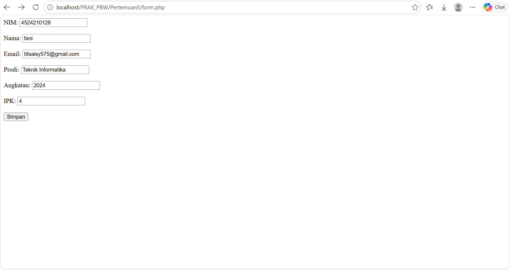
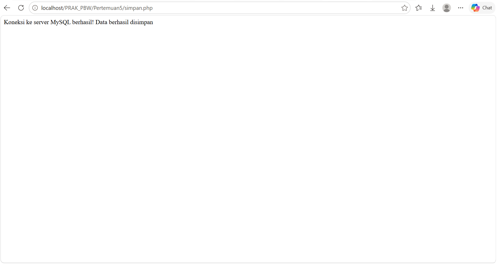
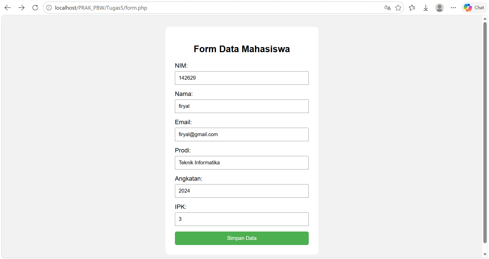
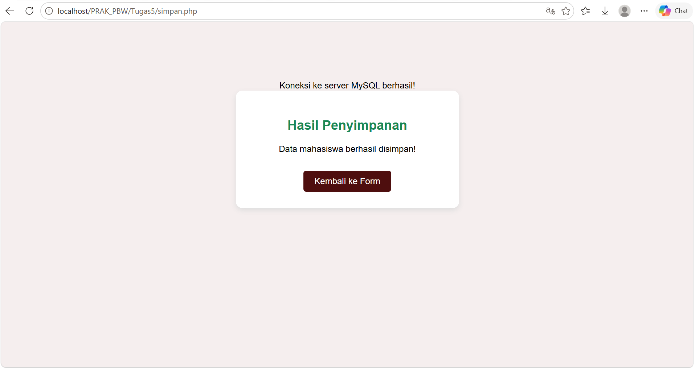

<div align="center"> 
 
<h1 style="font-size: 18px; margin-bottom: 5px; border: none;"> 
LAPORAN PRAKTIKUM <br> 
PEMROGRAMAN BERBASIS WEB 
</h1> 
 
<p style="font-size: 12px; color: #555;"> 
<i>"Laporan ini disusun untuk memenuhi salah satu penilaian mata kuliah Praktikum Pemrograman Berbasis Web"</i> 
</p> 
 
<br> 
 
 
 
<br><br> 
 
<p style="font-size: 14px; margin-bottom: 5px;"> 
<b>Disusun Oleh:</b> 
</p> 
 
<p style="font-size: 15px; margin-top: 5px;"> 
Rihhadatul Aisy Septifani Zain<br> 
4524210126 
</p> 
 
<br> 
 
<p style="font-size: 14px; margin-bottom: 5px;"> 
<b>Dosen:</b> 
</p> 
 
<p style="font-size: 14px; margin-top: 5px;"> 
Ari Wibowo, S.Kom., M.Kom., C. Pro 
</p> 
 
<br><br><br> 
 
<h3 style="font-size: 16px; margin-bottom: 5px; border: none;"> 
S1-TEKNIK INFORMATIKA <br> 
FAKULTAS TEKNIK UNIVERSITAS PANCASILA <br> 
<b>2026/2027</b> 
</h3> 
 
</div> 
 
--- 
 
# TUGAS 5
 
## Menjalankan Program Sebelum Modifikasi 
 
Program form.php dijalankan terlebih dahulu untuk memastikan proses pengolahan data pada database dapat berjalan dengan baik. 
 
### Tampilan sebelum dilakukan modifikasi 
 
 

## Menjalankan Program Sebelum Modifikasi 

Program simpan.php dijalankan terlebih dahulu untuk memastikan proses pengolahan data pada database dapat berjalan dengan baik. 

### Tampilan sebelum dilakukan modifikasi 


 
--- 
 
# Modifikasi Program 
 
## A. Modifikasi pada form.php dan simpan.php
 
### Tampilan Sesudah Modifikasi
 


### Tampilan Sesudah Modifikasi


 

## 1.) Membuat Form Data Mahasiswa

Pada program ditambahkan form data mahasiswa untuk memasukkan NIM, nama, email, program studi, angkatan, dan IPK. Form dibuat menggunakan HTML dan CSS agar tampilannya lebih rapi dan mudah digunakan.

**Code:**

```html
<form action="simpan.php" method="post">
    NIM:
    <input type="text" name="nim" required placeholder="Masukkan NIM">

    Nama:
    <input type="text" name="nama" required placeholder="Masukkan nama">

    Email:
    <input type="email" name="email" required placeholder="Masukkan email">

    Prodi:
    <input type="text" name="prodi" required placeholder="Masukkan program studi">

    Angkatan:
    <input type="number" name="angkatan" min="2000" max="2100" required placeholder="Masukkan angkatan">

    IPK:
    <input type="number" name="ipk" min="0" max="4" step="0.01" required placeholder="Masukkan IPK">

    <button type="submit">Simpan Data</button>
</form>
```

Form menggunakan atribut action="simpan.php" untuk mengirim data ke file simpan.php dengan metode POST. Atribut required memastikan setiap kolom harus diisi, sedangkan min, max, dan step digunakan untuk membatasi input angkatan dan IPK.

---

## 2.) Mengatur Tampilan Form Menggunakan CSS

Pada program ditambahkan CSS untuk mengatur warna latar belakang, posisi form, ukuran input, dan tampilan tombol agar lebih menarik.

**Code:**

```css
body {
    font-family: Arial, sans-serif;
    background-color: #f2f2f2;
    margin: 0;
    padding: 30px;
}

.container {
    width: 350px;
    margin: auto;
    background-color: white;
    padding: 25px;
    border-radius: 10px;
}

h2 {
    text-align: center;
}

input {
    width: 100%;
    padding: 8px;
    margin-top: 5px;
    margin-bottom: 15px;
    box-sizing: border-box;
}

button {
    width: 100%;
    padding: 10px;
    background-color: #4CAF50;
    color: white;
    border: none;
    border-radius: 5px;
    cursor: pointer;
}

button:hover {
    background-color: #388E3C;
}
```

CSS digunakan untuk membuat tampilan form lebih rapi. Efek button:hover mengubah warna tombol ketika kursor diarahkan ke tombol tersebut.

---

## 3.) Menghubungkan Form dengan Database

Pada file simpan.php, program menghubungkan database melalui file koneksi.php dan mengambil data yang dikirim dari form menggunakan metode POST.

**Code:**

```php
include "koneksi.php";

$nim = $_POST['nim'];
$nama = $_POST['nama'];
$email = $_POST['email'];
$prodi = $_POST['prodi'];
$angkatan = $_POST['angkatan'];
$ipk = $_POST['ipk'];
```

include "koneksi.php" digunakan untuk menghubungkan program dengan database. Variabel $_POST digunakan untuk mengambil data dari setiap input form agar dapat diproses dan disimpan ke tabel mahasiswa.

---

## 4.) Melakukan Validasi IPK

Program melakukan validasi untuk memastikan nilai IPK berada dalam rentang 0 sampai 4 sebelum data dimasukkan ke database.

**Code:**

```php
if ($ipk < 0 || $ipk > 4) {
    $pesan = "IPK harus antara 0 sampai 4.";
    $warna = "#dc3545";
} else {
    // Proses penyimpanan data
}
```

Kondisi if digunakan untuk memeriksa apakah IPK kurang dari 0 atau lebih dari 4. Jika IPK tidak sesuai, program menampilkan pesan kesalahan berwarna merah. Jika IPK valid, program melanjutkan proses penyimpanan data.

---

## 5.) Menyimpan Data Mahasiswa

Program menggunakan perintah INSERT untuk memasukkan data mahasiswa ke dalam tabel mahasiswa berdasarkan input yang telah diisi pada form.

**Code:**

```php
$query = mysqli_query(
    $koneksi,
    "INSERT INTO mahasiswa
    (nim, nama, email, prodi, angkatan, ipk)
    VALUES
    ('$nim', '$nama', '$email', '$prodi', '$angkatan', '$ipk')"
);
```

mysqli_query() digunakan untuk menjalankan perintah SQL ke database. Perintah `INSERT INTO` berfungsi menambahkan data baru ke dalam tabel mahasiswa sesuai dengan kolom yang ditentukan.

---

## 6.) Menampilkan Hasil Penyimpanan

Setelah proses penyimpanan dilakukan, program memeriksa apakah data berhasil dimasukkan ke database atau mengalami kegagalan.

**Code:**

```php
if ($query) {
    $pesan = "Data mahasiswa berhasil disimpan!";
    $warna = "#198754";
} else {
    $pesan = "Data gagal disimpan. NIM mungkin sudah terdaftar.";
    $warna = "#dc3545";
}
```

Jika query berhasil dijalankan, program menampilkan pesan keberhasilan berwarna hijau. Jika query gagal, program menampilkan pesan kesalahan berwarna merah.

---

## 7.) Membuat Tampilan Hasil Penyimpanan

Program menggunakan HTML dan CSS untuk menampilkan hasil penyimpanan dalam bentuk card yang berisi pesan dan tombol kembali ke form.

**Code:**

```html
<div class="card">
    <h2>Hasil Penyimpanan</h2>
    <p><?= htmlspecialchars($pesan) ?></p>
    <a href="form.php">Kembali ke Form</a>
</div>
```

Elemen div dengan class card digunakan sebagai wadah tampilan hasil. htmlspecialchars() digunakan untuk mengamankan teks pesan yang ditampilkan, sedangkan tautan Kembali ke Form memungkinkan pengguna kembali ke halaman pengisian data mahasiswa.

---

## 8.) Mengatur Warna Pesan Secara Dinamis

Program menggunakan variabel $warna untuk menentukan warna judul berdasarkan hasil proses penyimpanan.

**Code:**

```php
h2 {
    color: <?= $warna ?>;
}
```

Variabel $warna berisi kode warna yang ditentukan berdasarkan kondisi program. Warna hijau digunakan ketika data berhasil disimpan, sedangkan warna merah digunakan ketika terjadi kesalahan.

---
