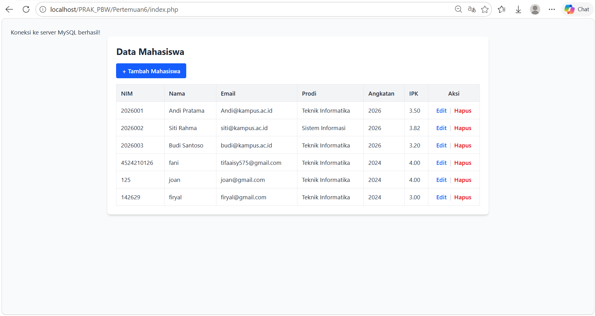
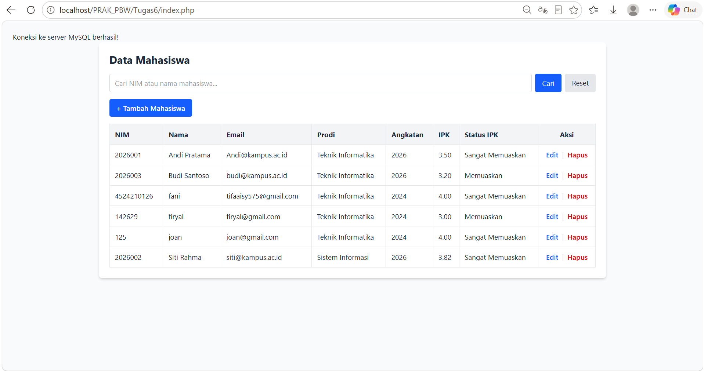
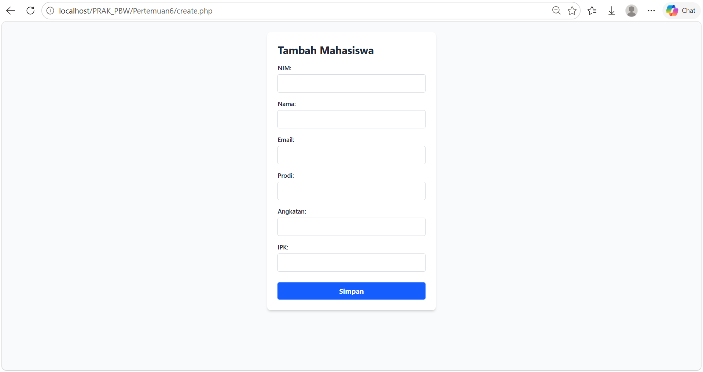
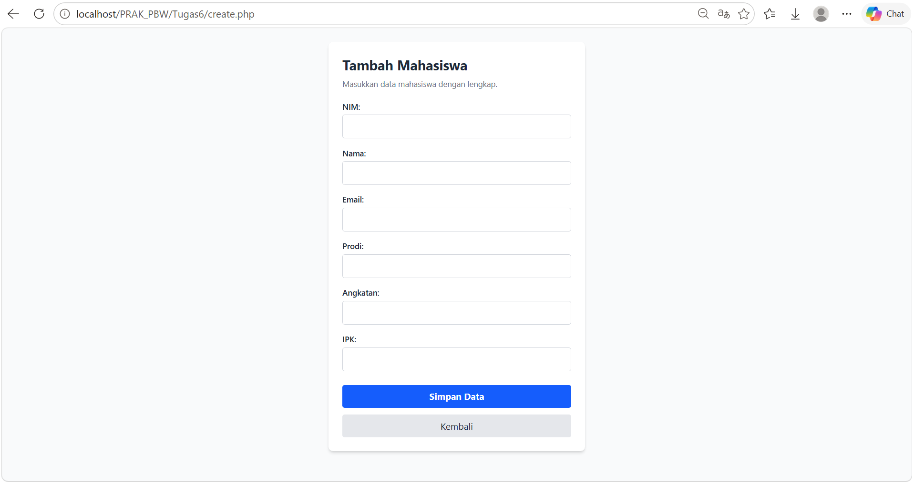
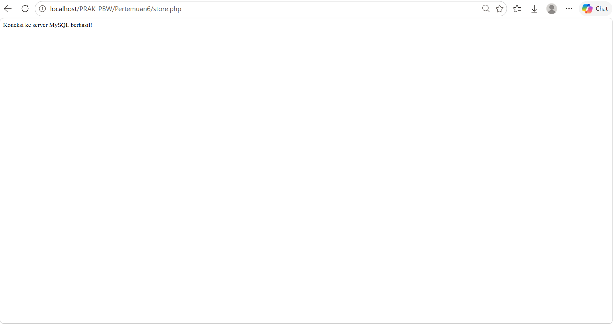
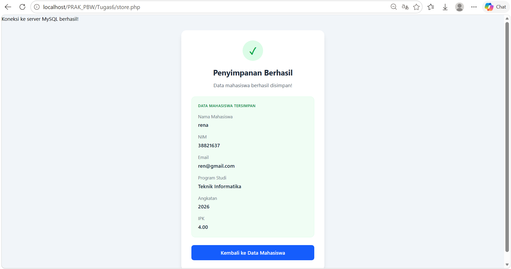

<div align="center"> 
 
<h1 style="font-size: 18px; margin-bottom: 5px; border: none;"> 
LAPORAN PRAKTIKUM <br> 
PEMROGRAMAN BERBASIS WEB 
</h1> 
 
<p style="font-size: 12px; color: #555;"> 
<i>"Laporan ini disusun untuk memenuhi salah satu penilaian mata kuliah Praktikum Pemrograman Berbasis Web"</i> 
</p> 
 
<br> 
 
 
 
<br><br> 
 
<p style="font-size: 14px; margin-bottom: 5px;"> 
<b>Disusun Oleh:</b> 
</p> 
 
<p style="font-size: 15px; margin-top: 5px;"> 
Rihhadatul Aisy Septifani Zain<br> 
4524210126 
</p> 
 
<br> 
 
<p style="font-size: 14px; margin-bottom: 5px;"> 
<b>Dosen:</b> 
</p> 
 
<p style="font-size: 14px; margin-top: 5px;"> 
Ari Wibowo, S.Kom., M.Kom., C. Pro 
</p> 
 
<br><br><br> 
 
<h3 style="font-size: 16px; margin-bottom: 5px; border: none;"> 
S1-TEKNIK INFORMATIKA <br> 
FAKULTAS TEKNIK UNIVERSITAS PANCASILA <br> 
<b>2026/2027</b> 
</h3> 
 
</div> 
 
--- 
 
# TUGAS 6

## 1. Modifikasi pada `index.php`

### Tampilan Sebelum Modifikasi

 

Pada program sebelum modifikasi, halaman index.php digunakan untuk menampilkan data mahasiswa dari database. Tabel menampilkan NIM, nama, email, program studi, angkatan, IPK, serta tombol untuk mengedit dan menghapus data.

### Tampilan Sesudah Modifikasi

 

Pada program setelah modifikasi, ditambahkan fitur pencarian berdasarkan NIM atau nama, pengurutan data berdasarkan nama, kolom status IPK, dan pesan ketika data tidak ditemukan. Selain itu, tampilan diperbaiki menggunakan Tailwind CSS dan output data diamankan menggunakan htmlspecialchars().

### Menambahkan Fitur Pencarian dan Pengurutan Data

**Code:**

```php
$keyword = trim($_GET['keyword'] ?? '');

$stmt = mysqli_prepare(
    $koneksi,
    "SELECT * FROM mahasiswa
     WHERE nim LIKE ? OR nama LIKE ?
     ORDER BY nama ASC"
);

$search = "%$keyword%";

mysqli_stmt_bind_param($stmt, "ss", $search, $search);
mysqli_stmt_execute($stmt);

$query = mysqli_stmt_get_result($stmt);
```

Kode tersebut digunakan untuk mencari mahasiswa berdasarkan NIM atau nama. Fungsi trim() menghapus spasi di awal dan akhir kata pencarian. mysqli_prepare() dan mysqli_stmt_bind_param() digunakan untuk menjalankan query dengan parameter, sedangkan ORDER BY nama ASC mengurutkan data berdasarkan nama secara alfabetis.

### Menambahkan Fungsi Keamanan Output

**Code:**

```php
function e($value) {
    return htmlspecialchars((string) $value, ENT_QUOTES, 'UTF-8');
}
```

Fungsi e() digunakan untuk mengamankan data yang ditampilkan pada halaman. htmlspecialchars() mengubah karakter khusus HTML menjadi bentuk yang aman sehingga membantu mengurangi risiko serangan XSS.

### Menambahkan Kolom Status IPK

**Code:**

```php
$ipk = (float) $data['ipk'];

if ($ipk >= 3.50) {
    echo "Sangat Memuaskan";
} elseif ($ipk >= 3.00) {
    echo "Memuaskan";
} elseif ($ipk >= 2.00) {
    echo "Cukup";
} else {
    echo "Perlu Peningkatan";
}
```

Kolom Status IPK ditambahkan untuk memberikan keterangan berdasarkan nilai IPK mahasiswa. IPK minimal 3,50 mendapatkan status Sangat Memuaskan, minimal 3,00 Memuaskan, minimal 2,00 Cukup, dan di bawah 2,00 mendapatkan status Perlu Peningkatan.

### Memperbaiki Format Nilai IPK

**Code:**

```php
<td class="border border-gray-200 p-3">
    <?= number_format((float) $data['ipk'], 2) ?>
</td>
```

Fungsi number_format() digunakan untuk menampilkan nilai IPK dengan dua angka di belakang koma agar tampilannya lebih konsisten dan mudah dibaca.

### Menambahkan Kondisi Ketika Data Tidak Ditemukan

**Code:**

```php
<?php if (mysqli_num_rows($query) > 0) { ?>
    <?php while ($data = mysqli_fetch_assoc($query)) { ?>
        <!-- Menampilkan data mahasiswa -->
    <?php } ?>
<?php } else { ?>
    <tr>
        <td colspan="8"
            class="border border-gray-200 p-4 text-center text-gray-500">
            Data mahasiswa tidak ditemukan.
        </td>
    </tr>
<?php } ?>
```

mysqli_num_rows() digunakan untuk memeriksa apakah query menghasilkan data. Jika data tersedia, program menampilkannya dalam tabel. Jika tidak ada data yang sesuai, program menampilkan pesan bahwa data mahasiswa tidak ditemukan.

### Menambahkan Form Pencarian dan Tombol Reset

**Code:**

```html
<form method="GET" class="mb-4 flex flex-wrap gap-2">
    <input
        type="text"
        name="keyword"
        value="<?= e($keyword) ?>"
        placeholder="Cari NIM atau nama mahasiswa..."
        class="flex-1 min-w-48 border border-gray-300 rounded px-3 py-2"
    >

    <button type="submit"
        class="bg-blue-600 hover:bg-blue-700 text-white px-4 py-2 rounded">
        Cari
    </button>

    <a href="index.php"
        class="bg-gray-200 hover:bg-gray-300 px-4 py-2 rounded">
        Reset
    </a>
</form>
```

Form pencarian menggunakan metode GET untuk mengirim kata kunci ke halaman index.php. Tombol Cari menjalankan pencarian, sedangkan tombol Reset membuka kembali halaman tanpa kata kunci sehingga seluruh data dapat ditampilkan.

---

## 2. Modifikasi pada `create.php`

### Tampilan Sebelum Modifikasi

 

Pada program sebelum modifikasi, file create.php digunakan untuk menampilkan form penambahan data mahasiswa yang terdiri dari NIM, nama, email, program studi, angkatan, dan IPK. Form menggunakan metode POST untuk mengirimkan data ke file store.php.

### Tampilan Sesudah Modifikasi

 

Pada program setelah modifikasi, ditambahkan validasi pada setiap input, pembatasan panjang NIM dan teks, batas nilai angkatan dan IPK, serta tombol kembali ke halaman utama. Tampilan form juga diperbaiki menggunakan Tailwind CSS agar lebih rapi dan mudah digunakan.

### Menambahkan Validasi NIM

**Code:**

```html
<input
    type="text"
    id="nim"
    name="nim"
    minlength="7"
    maxlength="15"
    required
    class="mb-4 p-2 border border-gray-300 rounded focus:outline-blue-500"
>
```

Atribut minlength="7" dan maxlength="15" digunakan untuk membatasi panjang NIM minimal 7 karakter dan maksimal 15 karakter. Atribut required memastikan kolom NIM harus diisi sebelum form dikirim.

### Menambahkan Batas Panjang Nama, Email, dan Prodi

**Code:**

```html
<input
    type="text"
    id="nama"
    name="nama"
    maxlength="100"
    required
    class="mb-4 p-2 border border-gray-300 rounded focus:outline-blue-500"
>

<input
    type="email"
    id="email"
    name="email"
    maxlength="100"
    required
    class="mb-4 p-2 border border-gray-300 rounded focus:outline-blue-500"
>

<input
    type="text"
    id="prodi"
    name="prodi"
    maxlength="100"
    required
    class="mb-4 p-2 border border-gray-300 rounded focus:outline-blue-500"
>
```

Atribut maxlength="100" ditambahkan untuk membatasi panjang nama, email, dan program studi maksimal 100 karakter. Tipe input email juga membantu memeriksa format email sebelum data dikirimkan.

### Membatasi Input Angkatan

**Code:**

```html
<input
    type="number"
    id="angkatan"
    name="angkatan"
    min="2000"
    max="2100"
    required
    class="mb-4 p-2 border border-gray-300 rounded focus:outline-blue-500"
>
```

Tipe input diubah dari text menjadi number agar angkatan hanya menerima input angka. Atribut min="2000" dan max="2100" digunakan untuk membatasi nilai angkatan yang dapat dimasukkan.

### Menambahkan Validasi Nilai IPK

**Code:**

```html
<input
    type="number"
    id="ipk"
    name="ipk"
    min="0"
    max="4"
    step="0.01"
    required
    class="mb-6 p-2 border border-gray-300 rounded focus:outline-blue-500"
>
```

Atribut min="0" dan max="4" membatasi nilai IPK dari 0 sampai 4. Atribut step="0.01" memungkinkan pengguna memasukkan nilai desimal dengan ketelitian dua angka di belakang koma, sedangkan required memastikan IPK wajib diisi.

### Memperbaiki Tampilan Form Menggunakan Tailwind CSS

**Code:**

```html
<form action="store.php" method="POST"
    class="max-w-md mx-auto bg-white p-6 rounded-lg shadow-md flex flex-col">

    <h2 class="text-2xl font-bold mb-2">Tambah Mahasiswa</h2>

    <p class="text-sm text-gray-500 mb-5">
        Masukkan data mahasiswa dengan lengkap.
    </p>
</form>
```

Tampilan form diperbaiki menggunakan Tailwind CSS. Kelas max-w-md membatasi lebar form, mx-auto membuat form berada di tengah halaman, rounded-lg memberikan sudut membulat, dan shadow-md menambahkan bayangan. Teks petunjuk juga ditambahkan agar pengguna mengetahui data yang harus diisi.

### Menambahkan Efek Fokus pada Input

**Code:**

```html
class="mb-4 p-2 border border-gray-300 rounded focus:outline-blue-500"
```

Kelas focus:outline-blue-500 ditambahkan agar input memiliki penanda berwarna biru ketika dipilih. Hal ini membantu pengguna mengetahui kolom yang sedang aktif saat mengisi form.

### Menambahkan Tombol Kembali

**Code:**

```html
<a href="index.php"
    class="text-center mt-3 bg-gray-200 hover:bg-gray-300 py-2 rounded">
    Kembali
</a>
```

Tombol Kembali ditambahkan agar pengguna dapat kembali ke halaman utama yang menampilkan daftar mahasiswa tanpa harus menggunakan tombol kembali pada browser. Efek hover:bg-gray-300 mengubah warna tombol ketika kursor diarahkan ke tombol tersebut.


---

## 3. Modifikasi pada `store.php`

### Tampilan Sebelum Modifikasi

 

Pada program sebelum modifikasi, file store.php digunakan untuk menerima data dari form create.php dan menyimpannya ke database menggunakan perintah INSERT. Program menampilkan pesan berhasil atau gagal melalui JavaScript alert, kemudian mengarahkan pengguna kembali ke halaman utama atau halaman sebelumnya.

### Tampilan Sesudah Modifikasi

 

Pada program setelah modifikasi, ditambahkan validasi input, pemeriksaan NIM dan email duplikat, penggunaan prepared statement untuk penyimpanan data, serta tampilan hasil penyimpanan yang lebih informatif. Program juga menampilkan detail mahasiswa ketika penyimpanan berhasil dan memberikan pilihan untuk kembali ke form apabila terjadi kesalahan.

### Menambahkan Validasi Input Mahasiswa

**Code:**

```php
$nim = trim($_POST['nim'] ?? '');
$nama = trim($_POST['nama'] ?? '');
$email = trim($_POST['email'] ?? '');
$prodi = trim($_POST['prodi'] ?? '');
$angkatan = $_POST['angkatan'] ?? '';
$ipk = $_POST['ipk'] ?? '';

if (
    $nim === '' ||
    $nama === '' ||
    $prodi === '' ||
    !filter_var($email, FILTER_VALIDATE_EMAIL) ||
    filter_var($angkatan, FILTER_VALIDATE_INT) === false ||
    (int) $angkatan < 2000 ||
    (int) $angkatan > 2100 ||
    !is_numeric($ipk) ||
    !is_finite((float) $ipk) ||
    (float) $ipk < 0 ||
    (float) $ipk > 4
) {
    $pesan = "Data tidak valid. Periksa kembali formulir!";
}
```

Validasi ditambahkan untuk memastikan data yang diterima sesuai dengan ketentuan. Fungsi trim() menghapus spasi di awal dan akhir input, filter_var() memeriksa format email dan bilangan bulat angkatan, sedangkan kondisi IPK memastikan nilainya berupa angka yang berada dalam rentang 0 sampai 4.

### Memeriksa NIM dan Email Duplikat

**Code:**

```php
$stmt = mysqli_prepare(
    $koneksi,
    "SELECT nim, email FROM mahasiswa
     WHERE nim = ? OR email = ?"
);

mysqli_stmt_bind_param($stmt, "ss", $nim, $email);
mysqli_stmt_execute($stmt);

$hasil = mysqli_stmt_get_result($stmt);

if (mysqli_num_rows($hasil) > 0) {
    $data = mysqli_fetch_assoc($hasil);

    if ($data['nim'] == $nim) {
        $pesan = "NIM sudah terdaftar. Gunakan NIM lain!";
    } else {
        $pesan = "Email sudah terdaftar. Gunakan email lain!";
    }
}
```

Pemeriksaan ini digunakan untuk mengetahui apakah NIM atau email sudah digunakan oleh mahasiswa lain. Jika ditemukan data yang sama, proses penyimpanan tidak dilanjutkan dan program menampilkan pesan sesuai dengan data yang duplikat.

### Menggunakan Prepared Statement untuk Menyimpan Data

**Code:**

```php
$stmt = mysqli_prepare(
    $koneksi,
    "INSERT INTO mahasiswa
    (nim, nama, email, prodi, angkatan, ipk)
    VALUES (?, ?, ?, ?, ?, ?)"
);

mysqli_stmt_bind_param(
    $stmt,
    "sssssd",
    $nim,
    $nama,
    $email,
    $prodi,
    $angkatan,
    $ipk
);

if (mysqli_stmt_execute($stmt)) {
    $berhasil = true;
    $pesan = "Data mahasiswa berhasil disimpan!";
} else {
    $pesan = "Data mahasiswa gagal disimpan.";
}
```

Perintah INSERT digunakan untuk menyimpan data mahasiswa ke database. mysqli_prepare() menyiapkan query dengan parameter, sedangkan mysqli_stmt_bind_param() menghubungkan nilai input dengan query. Prepared statement membantu mencegah SQL injection karena data dipisahkan dari perintah SQL.

### Menambahkan Penanganan Kesalahan Penyimpanan

**Code:**

```php
try {
    if (mysqli_stmt_execute($stmt)) {
        $berhasil = true;
        $pesan = "Data mahasiswa berhasil disimpan!";
    } else {
        $pesan = "Data mahasiswa gagal disimpan.";
    }
} catch (mysqli_sql_exception $e) {
    $pesan = "Data gagal disimpan. Periksa kembali NIM dan email.";
}
```

Blok try-catch digunakan untuk menangani kesalahan yang terjadi saat proses penyimpanan. Jika query berhasil, variabel $berhasil diatur menjadi true. Jika terjadi kesalahan database yang melempar exception, program menampilkan pesan kegagalan kepada pengguna.

### Mengamankan Pesan dan Detail Mahasiswa

**Code:**

```php
function e($value) {
    return htmlspecialchars((string) $value, ENT_QUOTES, 'UTF-8');
}
```

Fungsi e() digunakan untuk mengamankan teks yang ditampilkan pada halaman hasil penyimpanan. Fungsi htmlspecialchars() mengubah karakter khusus HTML menjadi bentuk yang aman sehingga membantu mengurangi risiko serangan XSS.

### Menampilkan Status Penyimpanan Secara Dinamis

**Code:**

```php
<div class="mx-auto mb-5 flex items-center justify-center
    w-16 h-16 rounded-full
    <?= $berhasil
        ? 'bg-green-100 text-green-600'
        : 'bg-red-100 text-red-600' ?>">

    <span class="text-3xl font-bold">
        <?= $berhasil ? '&#10003;' : '!' ?>
    </span>
</div>

<h1 class="text-2xl font-bold text-gray-800 mb-3">
    <?= $berhasil
        ? 'Penyimpanan Berhasil'
        : 'Penyimpanan Gagal' ?>
</h1>
```

Tampilan hasil dibuat dinamis berdasarkan nilai variabel $berhasil. Jika data berhasil disimpan, program menampilkan tanda centang dengan warna hijau dan judul Penyimpanan Berhasil. Jika gagal, program menampilkan tanda seru dengan warna merah dan judul Penyimpanan Gagal.

### Menampilkan Detail Data Mahasiswa

**Code:**

```php
<?php if ($berhasil) { ?>

    <p class="text-sm text-gray-500 mb-1">Nama Mahasiswa</p>
    <p class="font-semibold text-gray-800 mb-4 break-words">
        <?= e($nama) ?>
    </p>

    <p class="text-sm text-gray-500 mb-1">NIM</p>
    <p class="font-semibold text-gray-800 mb-4 break-words">
        <?= e($nim) ?>
    </p>

    <p class="text-sm text-gray-500 mb-1">IPK</p>
    <p class="font-semibold text-gray-800">
        <?= number_format((float) $ipk, 2) ?>
    </p>

<?php } ?>
```

Jika penyimpanan berhasil, program menampilkan detail mahasiswa yang baru disimpan, seperti nama, NIM, dan IPK. Fungsi e() digunakan untuk mengamankan teks, sedangkan number_format() menampilkan IPK dengan dua angka di belakang koma.

### Menambahkan Tombol Navigasi

**Code:**

```html
<a href="index.php"
    class="block w-full bg-blue-600 hover:bg-blue-700
    text-white font-semibold py-3 px-4 rounded-lg transition">
    Kembali ke Data Mahasiswa
</a>

<?php if (!$berhasil) { ?>
    <a href="create.php"
        class="block w-full mt-3 bg-gray-100 hover:bg-gray-200
        text-gray-700 font-semibold py-3 px-4 rounded-lg transition">
        Kembali ke Form Tambah
    </a>
<?php } ?>
```

Tombol Kembali ke Data Mahasiswa digunakan untuk membuka halaman utama. Jika penyimpanan gagal, tombol Kembali ke Form Tambah juga ditampilkan agar pengguna dapat memperbaiki input dan mencoba menyimpan kembali.


---

## 4. Modifikasi pada `edit.php`

### Tampilan Sebelum Modifikasi

Pada program sebelum modifikasi, file `edit.php` digunakan untuk mengambil data mahasiswa berdasarkan NIM dan menampilkan form yang berisi data lama. Pengguna dapat mengubah NIM, nama, email, program studi, angkatan, dan IPK, kemudian mengirim perubahan ke file `update.php`.

### Tampilan Sesudah Modifikasi

Pada program setelah modifikasi, ditambahkan validasi NIM, penggunaan prepared statement untuk mengambil data, penanganan ketika data tidak ditemukan, dan pengamanan output menggunakan `htmlspecialchars()`. NIM juga dibuat tidak dapat diubah, sementara tampilan form diperbaiki agar lebih rapi dan responsif.

### 4.1 Menggunakan Prepared Statement untuk Mengambil Data

**Code:**

```php
$nim = trim($_GET['nim'] ?? '');

if ($nim === '') {
    echo "<script>
        alert('NIM tidak ditemukan!');
        window.location.href = 'index.php';
    </script>";
    exit;
}

$stmt = mysqli_prepare(
    $koneksi,
    "SELECT * FROM mahasiswa WHERE nim = ?"
);

mysqli_stmt_bind_param($stmt, "s", $nim);
mysqli_stmt_execute($stmt);

$result = mysqli_stmt_get_result($stmt);
$data = mysqli_fetch_assoc($result);
```

Kode tersebut digunakan untuk mengambil data mahasiswa berdasarkan NIM yang dikirim melalui URL. `trim()` membersihkan spasi pada NIM, sedangkan prepared statement membantu mencegah SQL injection karena nilai NIM dikirim sebagai parameter query.

### 4.2 Menambahkan Pemeriksaan Data Mahasiswa

**Code:**

```php
if (!$data) {
    echo "<script>
        alert('Data mahasiswa tidak ditemukan!');
        window.location.href = 'index.php';
    </script>";
    exit;
}
```

Kondisi `if (!$data)` digunakan untuk memeriksa apakah data mahasiswa ditemukan di database. Jika data tidak ditemukan, program menampilkan pesan peringatan dan mengarahkan pengguna kembali ke halaman utama.

### 4.3 Menambahkan Fungsi Keamanan Output

**Code:**

```php
function e($value) {
    return htmlspecialchars((string) $value, ENT_QUOTES, 'UTF-8');
}
```

Fungsi `e()` digunakan untuk mengamankan data yang ditampilkan pada halaman edit. `htmlspecialchars()` mengubah karakter khusus HTML menjadi bentuk yang aman sehingga membantu mengurangi risiko serangan XSS.

### 4.4 Membuat NIM Tidak Dapat Diubah

**Code:**

```html
<div class="mb-6 rounded-lg bg-blue-50 border border-blue-100 p-4">
    <p class="text-sm text-gray-500">NIM Mahasiswa</p>
    <p class="text-lg font-bold text-blue-800">
        <?= e($data['nim']) ?>
    </p>

    <input type="hidden" name="nim"
        value="<?= e($data['nim']) ?>">

    <p class="text-xs text-gray-500 mt-1">
        NIM digunakan sebagai identitas dan tidak dapat diubah.
    </p>
</div>
```

NIM ditampilkan sebagai identitas mahasiswa dan tidak lagi menggunakan input yang dapat diedit. Nilai NIM dikirim ke `update.php` melalui input bertipe `hidden` agar dapat digunakan untuk menentukan data yang akan diperbarui.

### 4.5 Menambahkan Validasi pada Form Edit

**Code:**

```html
<input type="number" id="angkatan" name="angkatan"
    value="<?= e($data['angkatan']) ?>"
    min="2000" max="2100" required
    class="w-full rounded-lg border border-gray-300 p-3 focus:border-blue-500 focus:ring-2 focus:ring-blue-100 outline-none">

<input type="number" id="ipk" name="ipk"
    value="<?= e($data['ipk']) ?>"
    min="0" max="4" step="0.01" required
    class="w-full rounded-lg border border-gray-300 p-3 focus:border-blue-500 focus:ring-2 focus:ring-blue-100 outline-none">
```

Validasi ditambahkan untuk membatasi angkatan dari 2000 sampai 2100 dan IPK dari 0 sampai 4. Atribut `required` memastikan kolom harus diisi, sedangkan `step="0.01"` memungkinkan IPK menggunakan dua angka di belakang koma.

### 4.6 Memperbaiki Tampilan Form Menggunakan Tailwind CSS

**Code:**

```html
<div class="bg-white rounded-2xl shadow-lg overflow-hidden">

    <div class="bg-blue-700 text-white p-6">
        <p class="text-blue-100 text-sm mb-1">DATA AKADEMIK</p>
        <h1 class="text-2xl font-bold">Edit Data Mahasiswa</h1>
        <p class="text-sm text-blue-100 mt-2">
            Perbarui informasi mahasiswa pada formulir berikut.
        </p>
    </div>
```

Tampilan form diperbaiki dengan menambahkan bagian judul berwarna biru, sudut membulat, bayangan, dan petunjuk pengisian. Tailwind CSS digunakan agar tampilan lebih terstruktur dan nyaman digunakan.

### 4.7 Mengatur Form Menjadi Responsif

**Code:**

```html
<div class="grid grid-cols-1 md:grid-cols-2 gap-5">
```

Kelas `grid-cols-1` membuat input tersusun dalam satu kolom pada layar kecil, sedangkan `md:grid-cols-2` mengatur dua kolom pada layar berukuran sedang atau lebih besar. Dengan demikian, form dapat menyesuaikan ukuran layar perangkat.

### 4.8 Menambahkan Tombol Simpan Perubahan dan Batal

**Code:**

```html
<div class="flex flex-col sm:flex-row gap-3 mt-8">
    <button type="submit"
        class="flex-1 bg-blue-600 hover:bg-blue-700 text-white font-semibold py-3 rounded-lg transition">
        Simpan Perubahan
    </button>

    <a href="index.php"
        class="flex-1 text-center bg-gray-100 hover:bg-gray-200 text-gray-700 font-semibold py-3 rounded-lg transition">
        Batal
    </a>
</div>
```

Tombol Simpan Perubahan digunakan untuk mengirim data yang telah diperbarui ke `update.php`. Tombol Batal digunakan untuk kembali ke halaman utama tanpa mengirim perubahan.


## 5. Modifikasi File `update.php`

File `update.php` digunakan untuk memperbarui data mahasiswa yang sudah diedit melalui form. Pada kode awal, data langsung diambil dari `$_POST` dan dimasukkan ke query SQL. Kode kemudian dimodifikasi dengan menambahkan validasi, prepared statement, pengecekan NIM, serta tampilan hasil pembaruan yang lebih informatif.

### A. Kode Sebelum Modifikasi

```php
<?php
include "koneksi.php";

$nim = $_POST['nim'];
$nama = $_POST['nama'];
$email = $_POST['email'];
$prodi = $_POST['prodi'];
$angkatan = $_POST['angkatan'];
$ipk = $_POST['ipk'];

$query = mysqli_query(
    $koneksi,
    "UPDATE mahasiswa
    SET nama='$nama',
        email='$email',
        prodi='$prodi',
        angkatan='$angkatan',
        ipk='$ipk'
    WHERE nim='$nim'"
);

if ($query) {
    echo "<script>
            alert('Data mahasiswa berhasil diubah');
            window.location.href = 'index.php';
          </script>";
} else {
    echo "<script>
            alert('Data gagal diubah');
            window.history.back();
          </script>";
}
?>
```

**Penjelasan:**
Kode awal memperbarui data mahasiswa berdasarkan NIM menggunakan query `UPDATE`. Namun, kode belum memiliki validasi input dan masih memasukkan data langsung ke query SQL sehingga berisiko terhadap SQL Injection.

### B. Kode Setelah Modifikasi

```php
// Modifikasi 1: Validasi data mahasiswa
if (
    $nim === '' ||
    $nama === '' ||
    $prodi === '' ||
    !filter_var($email, FILTER_VALIDATE_EMAIL) ||
    filter_var($angkatan, FILTER_VALIDATE_INT) === false ||
    (int) $angkatan < 2000 ||
    (int) $angkatan > 2100 ||
    !is_numeric($ipk) ||
    !is_finite((float) $ipk) ||
    (float) $ipk < 0 ||
    (float) $ipk > 4
) {
    $pesan = "Data tidak valid. Periksa kembali input!";
}
```

**Penjelasan:**
Ditambahkan validasi untuk memastikan data wajib diisi, format email benar, angkatan berada pada rentang 2000–2100, dan IPK berada di antara 0 sampai 4. Validasi ini membantu mencegah data yang tidak sesuai masuk ke database.

```php
// Modifikasi 2: Memeriksa keberadaan NIM
$stmt = mysqli_prepare(
    $koneksi,
    "SELECT nim FROM mahasiswa WHERE nim = ?"
);

mysqli_stmt_bind_param($stmt, "s", $nim);
mysqli_stmt_execute($stmt);

$hasil = mysqli_stmt_get_result($stmt);

if (mysqli_num_rows($hasil) == 0) {
    $pesan = "Data mahasiswa tidak ditemukan!";
}
```

**Penjelasan:**
Sebelum memperbarui data, sistem memeriksa apakah NIM yang dimasukkan benar-benar tersedia di database. Jika data tidak ditemukan, proses pembaruan tidak dilanjutkan.

```php
// Modifikasi 3: Menggunakan prepared statement
$stmt = mysqli_prepare(
    $koneksi,
    "UPDATE mahasiswa
     SET nama = ?,
         email = ?,
         prodi = ?,
         angkatan = ?,
         ipk = ?
     WHERE nim = ?"
);

mysqli_stmt_bind_param(
    $stmt,
    "sssids",
    $nama,
    $email,
    $prodi,
    $angkatan,
    $ipk,
    $nim
);
```

**Penjelasan:**
Query `UPDATE` diubah menggunakan prepared statement dan parameter terpisah. Cara ini membantu mencegah SQL Injection serta membuat proses pembaruan data lebih aman.

```php
// Modifikasi 4: Menampilkan status pembaruan
if (mysqli_stmt_execute($stmt)) {
    $berhasil = true;
    $pesan = "Data mahasiswa berhasil diperbarui!";
} else {
    $pesan = "Data gagal diperbarui.";
}
```

**Penjelasan:**
Hasil pembaruan disimpan dalam variabel `$berhasil` dan `$pesan`. Variabel tersebut digunakan untuk menentukan apakah sistem menampilkan status berhasil atau gagal kepada pengguna.

```php
// Modifikasi 5: Mengamankan output
function e($value) {
    return htmlspecialchars(
        (string) $value,
        ENT_QUOTES,
        'UTF-8'
    );
}
```

**Penjelasan:**
Fungsi `e()` digunakan untuk mengamankan teks yang ditampilkan pada halaman dengan mengubah karakter khusus HTML. Fungsi ini membantu mengurangi risiko Cross-Site Scripting (XSS).

### C. Modifikasi Tampilan Hasil Pembaruan

Selain mengubah proses PHP, tampilan hasil pembaruan juga dibuat lebih informatif menggunakan Tailwind CSS.

- Menampilkan ikon dan warna hijau jika pembaruan berhasil, atau merah jika gagal.
- Menampilkan nama mahasiswa, NIM, dan IPK terbaru setelah pembaruan berhasil.
- Menambahkan tombol **Kembali ke Data Mahasiswa** untuk membuka daftar mahasiswa.
- Menambahkan tombol **Kembali ke Form Edit** apabila pembaruan gagal.
- Menggunakan desain responsif agar tampilan tetap nyaman digunakan pada berbagai ukuran layar.


## 6. Modifikasi File `delete.php`

File `delete.php` digunakan untuk menghapus data mahasiswa berdasarkan NIM. Pada kode awal, proses penghapusan dilakukan langsung menggunakan query SQL dan menampilkan pesan melalui JavaScript. Setelah dimodifikasi, proses penghapusan dilengkapi pengecekan data, prepared statement, penanganan error, dan tampilan hasil penghapusan.

### A. Kode Sebelum Modifikasi

```php
<?php
include "koneksi.php";

$nim = $_GET['nim'];

$query = mysqli_query(
    $koneksi,
    "DELETE FROM mahasiswa
    WHERE nim='$nim'"
);

if ($query) {
    echo "<script>
            alert('Data mahasiswa berhasil dihapus');
            window.location.href = 'index.php';
          </script>";
} else {
    echo "<script>
            alert('Data gagal dihapus');
            window.history.back();
          </script>";
}
?>
```

Kode awal mengambil NIM melalui `$_GET['nim']`, kemudian langsung menjalankan query `DELETE` untuk menghapus data mahasiswa. Namun, kode belum memeriksa apakah NIM tersedia dan masih menggunakan query SQL yang berisiko terhadap SQL Injection.

### B. Kode Setelah Modifikasi

#### 1. Memeriksa NIM dan Mengambil Data Mahasiswa

```php
$nim = trim($_GET['nim'] ?? '');
$nama = "";
$email = "";

if ($nim === '') {
    $pesan = "NIM mahasiswa tidak ditemukan!";
} else {
    $stmt = mysqli_prepare(
        $koneksi,
        "SELECT nama, email FROM mahasiswa WHERE nim = ?"
    );

    mysqli_stmt_bind_param($stmt, "s", $nim);
    mysqli_stmt_execute($stmt);

    $hasil = mysqli_stmt_get_result($stmt);
    $data = mysqli_fetch_assoc($hasil);
}
```

Ditambahkan pemeriksaan NIM agar sistem dapat menangani parameter yang kosong. Sistem juga mengambil nama dan email mahasiswa sebelum penghapusan supaya informasi data yang dihapus dapat ditampilkan kembali kepada pengguna.

#### 2. Menghapus Data dengan Prepared Statement

```php
$stmt = mysqli_prepare(
    $koneksi,
    "DELETE FROM mahasiswa WHERE nim = ?"
);

mysqli_stmt_bind_param($stmt, "s", $nim);

if (mysqli_stmt_execute($stmt)) {
    $berhasil = true;
    $pesan = "Data mahasiswa berhasil dihapus dari database.";
} else {
    $pesan = "Data mahasiswa gagal dihapus.";
}
```

Query penghapusan diubah menggunakan prepared statement dengan parameter NIM. Modifikasi ini membantu mencegah SQL Injection dan membuat proses penghapusan lebih aman dibandingkan memasukkan nilai langsung ke query.

#### 3. Memeriksa Apakah Data Ditemukan

```php
if (!$data) {
    $pesan = "Data mahasiswa tidak ditemukan atau sudah dihapus!";
} else {
    $nama = $data['nama'];
    $email = $data['email'];
}
```

Sistem memeriksa hasil pencarian mahasiswa sebelum menjalankan penghapusan. Jika data tidak ditemukan atau sudah dihapus, sistem menampilkan pesan yang sesuai dan tidak melanjutkan proses penghapusan.

#### 4. Menangani Kesalahan Penghapusan

```php
try {
    if (mysqli_stmt_execute($stmt)) {
        $berhasil = true;
        $pesan = "Data mahasiswa berhasil dihapus dari database.";
    } else {
        $pesan = "Data mahasiswa gagal dihapus.";
    }
} catch (mysqli_sql_exception $e) {
    $pesan = "Data gagal dihapus karena masih memiliki relasi dengan data lain.";
}
```

Ditambahkan penanganan error untuk memberikan informasi ketika penghapusan gagal, misalnya karena data mahasiswa masih terhubung dengan data lain melalui relasi database. Penanganan ini bergantung pada konfigurasi MySQLi dan aturan relasi database yang digunakan.

#### 5. Mengamankan Data yang Ditampilkan

```php
function e($value) {
    return htmlspecialchars(
        (string) $value,
        ENT_QUOTES,
        'UTF-8'
    );
}
```

Fungsi e() digunakan untuk mengamankan teks yang ditampilkan pada halaman, seperti nama, NIM, email, dan pesan. Fungsi ini membantu mengurangi risiko Cross-Site Scripting (XSS).
