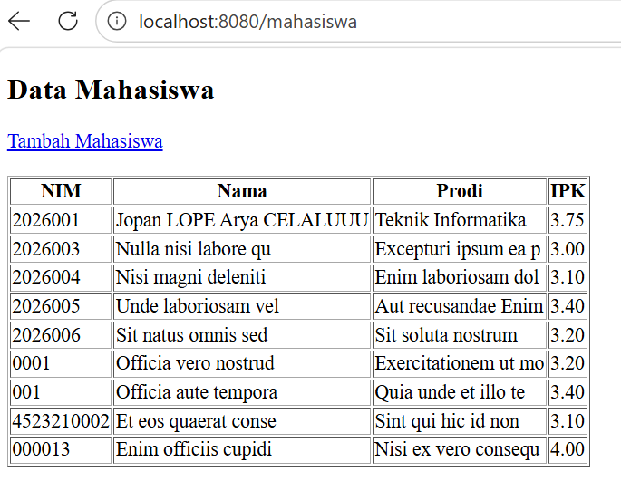
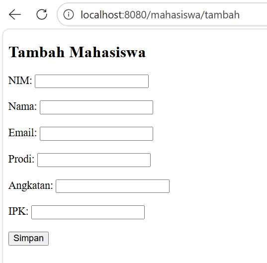
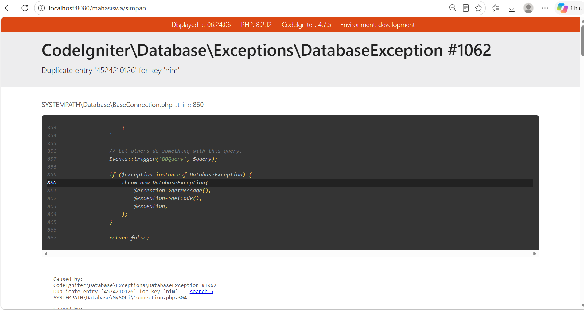

<h1 style="font-size: 18px; margin-bottom: 5px; border: none;">
LAPORAN PRAKTIKUM  
PEMROGRAMAN BERBASIS WEB
</h1>

<i>"Laporan ini disusun untuk memenuhi salah satu penilaian mata kuliah Praktikum Pemrograman Berbasis Web"</i>

 

  

<b>Disusun Oleh:</b>

Rihhadatul Aisy Septifani Zain 
4524210126

 

<b>Dosen:</b>

Ari Wibowo, S.Kom., M.Kom., C. Pro

   

<h3 style="font-size: 16px; margin-bottom: 5px; border: none;">
S1-TEKNIK INFORMATIKA  
FAKULTAS TEKNIK UNIVERSITAS PANCASILA  
<b>2026/2027</b>
</h3>

---

# TUGAS 8

## Data Mahasiswa
Menampilkan daftar mahasiswa yang tersimpan di database dalam bentuk tabel, meliputi NIM, nama, program studi, dan IPK.

## Tambah Data
Menampilkan halaman form untuk menambahkan data mahasiswa baru dengan seluruh kolom input masih kosong.

## Isi Data
Menunjukkan form tambah mahasiswa yang sudah diisi dengan NIM, nama, email, prodi, angkatan, dan IPK sebelum menekan tombol Simpan.

## Tampilan Data Tersimpan
Menampilkan data mahasiswa yang sudah berhasil disimpan ke database, termasuk data Budi Santoso dengan NIM 4524210126.

## Pesan Kesalahan
Terjadi kesalahan ketika menginput menggunakan isi data yang sama karena NIM 4524210126 sudah terdaftar di database, sehingga tidak bisa ditambahkan kembali karena NIM bersifat unik.

